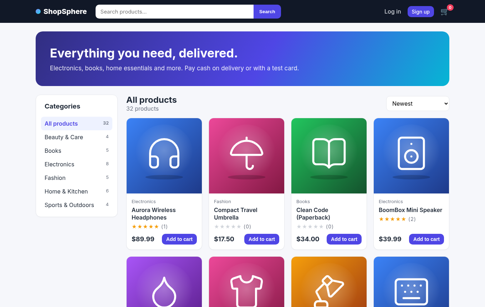
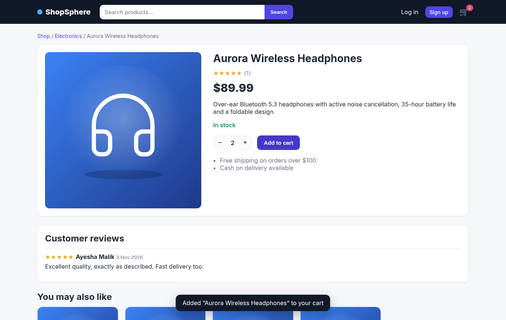
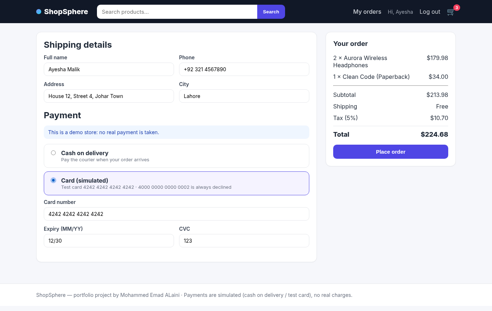
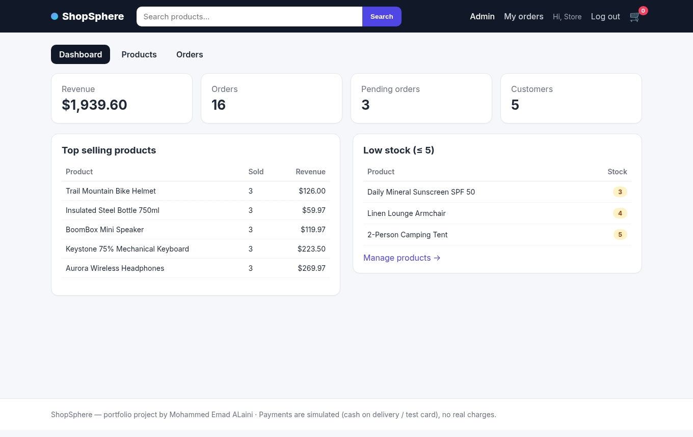

# ShopSphere — Full-Stack E-Commerce Platform

A complete online store built with **React (Vite) + Node.js/Express + SQLite**: product catalog with categories, search, sorting and pagination, product pages with reviews, a persisted shopping cart, checkout that creates real orders in one database transaction, JWT authentication with refresh-token rotation, order history, and an admin panel for products and orders.

> **No real payments.** Checkout supports *cash on delivery* and a *simulated card* (format checks only, nothing is charged, only the last 4 digits are stored).




## Features

**Shop**
- Catalog with 6 categories and 32 seeded products, live product counts per category
- Search (name + description), price filter, sort (newest, price, rating, name) and pagination
- Product page with stock status, quantity picker, star ratings, reviews and related products
- Cart that works for guests (saved in `localStorage`) and is **merged into the saved database cart after login**
- Checkout with shipping details, totals (5% tax, free shipping over $100) and two payment options:
  - **Cash on delivery** — order is `pending`, payment is marked paid when the order is delivered
  - **Simulated card** — Luhn + expiry check, test card `4242 4242 4242 4242`, `4000 0000 0000 0002` always declines
- Order confirmation, order history and order details

**Accounts & security**
- Register / login with bcrypt hashing and validation (zod)
- Short-lived JWT access token + **single-use refresh tokens** stored as SHA-256 hashes, with reuse detection (same pattern as my [rest-api-auth-system](https://github.com/Mo-aini/rest-api-auth-system))
- The React client refreshes the session automatically on a `401`
- Login rate limiting, `helmet` security headers, role-based admin routes

**Admin panel** (`admin@shop.test`)
- Dashboard: revenue, orders, pending orders, customers, top-selling products and low-stock alerts
- Product CRUD with unique slugs (products that already appear in orders are hidden instead of deleted)
- Orders list with status filter and a status workflow (`pending → paid → shipped → delivered`, or `cancelled` which restocks items and refunds card payments)

**Data integrity**
- The whole checkout (stock check → order → items → stock decrement → payment → clear cart) runs in **one SQLite transaction** — a declined card leaves nothing behind
- Money stored as integer cents, price snapshots in `order_items`, `CHECK (stock >= 0)`

## Tech Stack

| Part | Technologies |
| --- | --- |
| Client | React 19, React Router 7, Vite, plain CSS (responsive) |
| Server | Node.js 18+, Express 5, better-sqlite3, zod, jsonwebtoken, bcryptjs, helmet, express-rate-limit |
| Database | SQLite (file created on first run, zero setup) |
| Tests | Jest + Supertest (30 API tests on an in-memory database) |

## Project Structure

```
ecommerce-platform-fullstack/
├── server/
│   ├── src/
│   │   ├── app.js                 # Express app (also serves client/dist in production)
│   │   ├── db/schema.sql          # customers, categories, products, cart_items, orders, order_items, payments, reviews
│   │   ├── routes/                # auth, catalog, cart, orders, admin
│   │   ├── services/              # tokenService (JWT + refresh rotation), checkoutService (transaction)
│   │   ├── middleware/            # auth, validate (zod), errorHandler
│   │   └── utils/                 # money (totals, Luhn), slugify, HttpError
│   ├── scripts/seed.js            # demo data (+ seed-data.json)
│   ├── public/images/products/    # locally generated product images (SVG)
│   └── tests/                     # Jest + Supertest
├── client/
│   ├── src/
│   │   ├── api.js                 # fetch wrapper with automatic token refresh
│   │   ├── context/               # AuthContext, CartContext (guest + server cart)
│   │   ├── components/            # Navbar, ProductCard, Stars, RequireAuth…
│   │   └── pages/                 # Shop, ProductPage, Cart, Checkout, Orders, admin/*
│   └── vite.config.js             # proxies /api and /images to the server in dev
└── docs/database-schema.md        # ER diagram + order status diagram
```

## How to Run

Requirements: **Node.js 18+** and npm. No database server needed.

1. **Clone and install**
   ```bash
   git clone https://github.com/Mo-aini/ecommerce-platform-fullstack.git
   cd ecommerce-platform-fullstack
   cd server && npm install && cd ..
   cd client && npm install && cd ..
   # or simply: npm run setup
   ```
2. **Configure the server**
   ```bash
   cp server/.env.example server/.env    # set JWT_ACCESS_SECRET to a long random string
   ```
3. **Seed demo data** (creates `server/data/shop.db`)
   ```bash
   cd server && npm run seed
   ```
4. **Start the API** (terminal 1) — http://localhost:4000
   ```bash
   cd server && npm run dev
   ```
5. **Start the React app** (terminal 2) — http://localhost:5173
   ```bash
   cd client && npm run dev
   ```
6. **Log in** with a demo account:

   | Role | Email | Password |
   | --- | --- | --- |
   | Customer | `ayesha@shop.test` | `Customer1` |
   | Admin | `admin@shop.test` | `Admin1234` |

**Run the tests:** `cd server && npm test`

**Production build:** `cd client && npm run build`, then `cd server && npm start` — the Express server serves the built React app and the API on one port.

## API Overview

| Method | Endpoint | Auth |
| --- | --- | --- |
| POST | `/api/auth/register`, `/api/auth/login`, `/api/auth/refresh`, `/api/auth/logout` | – |
| GET | `/api/auth/me` | customer |
| GET | `/api/categories` | – |
| GET | `/api/products?q&category&minPrice&maxPrice&sort&page&limit` | – |
| GET | `/api/products/:slug` (product + reviews + related) | – |
| POST | `/api/products/:id/reviews` (only after ordering it) | customer |
| GET / DELETE | `/api/cart` | customer |
| PUT / DELETE | `/api/cart/items/:productId` | customer |
| POST | `/api/cart/merge` (guest cart → saved cart) | customer |
| POST / GET | `/api/orders` (checkout / my orders) | customer |
| GET | `/api/orders/:id` | owner or admin |
| GET | `/api/admin/stats` | admin |
| GET / POST / PUT / DELETE | `/api/admin/products[/:id]` | admin |
| GET | `/api/admin/orders?status=` | admin |
| PATCH | `/api/admin/orders/:id/status` | admin |

Example:

```bash
curl "http://localhost:4000/api/products?q=book&sort=price_asc&limit=3"
```

## Screenshots

| Product page | Checkout (simulated payment) |
| --- | --- |
|  |  |

**Admin dashboard**



The database design is documented in [docs/database-schema.md](docs/database-schema.md).

## What I Learned

- Designing a relational schema for a store and keeping it consistent with **transactions** (a declined card must not leave an order or reduce stock)
- Why money should be stored in cents and why order lines need a **price snapshot**
- Handling **two cart sources** (guest `localStorage` and the database) and merging them at login without exceeding stock
- Reusing my JWT + refresh-token-rotation design from a backend-only project in a real React client, including an automatic refresh on `401`
- Writing API tests that cover business rules (stock limits, status workflow, review permissions), not only happy paths
- A bug I found with an end-to-end browser run: logging out from a protected page sent the next user to that page after login; logout now navigates home first

## Credits

Product images are generated locally from [Lucide](https://lucide.dev) icons (ISC license) on gradient backgrounds. Product names and data are fictional demo data.

## Author

**Mohammed Emad ALaini** — BS Software Engineering, Superior University

## License

[MIT](LICENSE)
