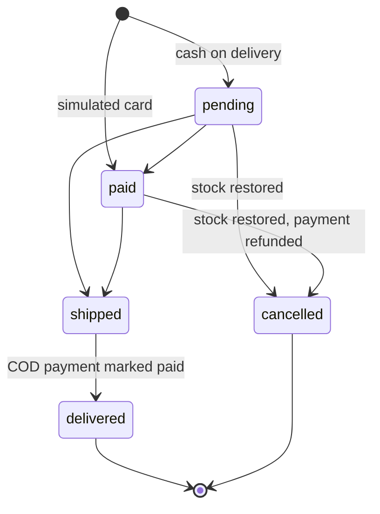

# Database schema

SQLite, created automatically from `server/src/db/schema.sql`. Modeled on a classic e-commerce schema
(customers, categories, products, orders, order_items, payments, reviews) plus a persisted cart and refresh tokens.

```mermaid
erDiagram
    CUSTOMERS ||--o{ ORDERS : places
    CUSTOMERS ||--o{ REVIEWS : writes
    CUSTOMERS ||--o{ CART_ITEMS : has
    CUSTOMERS ||--o{ REFRESH_TOKENS : owns
    CATEGORIES ||--o{ PRODUCTS : contains
    PRODUCTS ||--o{ ORDER_ITEMS : "sold as"
    PRODUCTS ||--o{ REVIEWS : receives
    PRODUCTS ||--o{ CART_ITEMS : "added as"
    ORDERS ||--|{ ORDER_ITEMS : includes
    ORDERS ||--|| PAYMENTS : "paid by"

    CUSTOMERS { int id PK; text name; text email UK; text password_hash; text role }
    CATEGORIES { int id PK; text name UK; text slug UK }
    PRODUCTS { int id PK; int category_id FK; text name; text slug UK; int price_cents; int stock; int is_active }
    CART_ITEMS { int customer_id PK; int product_id PK; int quantity }
    ORDERS { int id PK; int customer_id FK; text status; int subtotal_cents; int shipping_cents; int tax_cents; int total_cents }
    ORDER_ITEMS { int id PK; int order_id FK; int product_id FK; text product_name; int unit_price_cents; int quantity }
    PAYMENTS { int id PK; int order_id FK; text method; text status; int amount_cents; text card_last4 }
    REVIEWS { int id PK; int product_id FK; int customer_id FK; int rating; text comment }
    REFRESH_TOKENS { int id PK; int customer_id FK; text token_hash UK; text family_id; text expires_at }
```

## Design notes

- **Money is stored in integer cents** (`price_cents`, `total_cents`) — no floating point rounding errors.
- **`order_items` keeps a snapshot** of the product name and unit price, so editing a product later never changes old orders.
- **Stock can never go negative**: `CHECK (stock >= 0)` plus `UPDATE … WHERE stock >= ?` inside the checkout transaction.
- **One review per customer per product**: `UNIQUE (product_id, customer_id)`; the API also requires a previous order.
- **Payments are simulated**: `method` is `cod` (cash on delivery) or `card_simulated`. Only the last 4 card digits are stored.
- **Order status flow** (enforced by the admin API):


